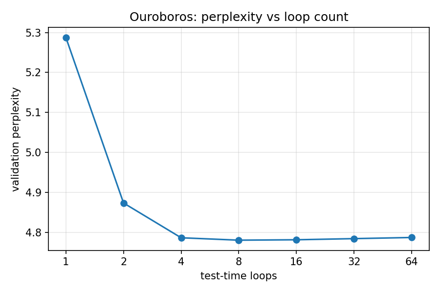
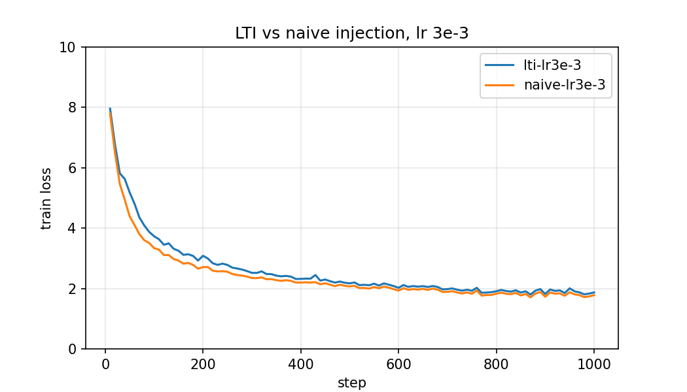

# Ouroboros

Started: 2026-06-04

**A looped transformer written from scratch in PyTorch, as a learning project.**

Instead of stacking unique layers, Ouroboros runs one shared block several
times, and the number of loops can be changed at test time. Along the way it
implements the standard parts of a modern LLM: GQA, a KV cache, RoPE, and a
mixture of experts. The papers behind each part are in the
[roadmap](docs/ROADMAP.md).

---

## Highlights

- **Prelude / Recurrent / Coda** (from Huginn): a looped core between small
  dense encode and decode stacks, rather than a fully looped network.
- **LTI-stable looping** (from Parcae): the recurrent update uses a diagonal
  state matrix whose spectral radius is `ρ(A) < 1` by construction, so the
  linear part of the loop cannot blow up whatever the optimizer does.
- **Test-time loop count**: a random loop count per training step plus
  truncated backprop (from Huginn), and a sinusoidal loop-index signal that is
  defined at any depth.
- **GQA with QK-norm and a KV cache**: each loop iteration keeps its own cache
  entries, so grouped KV heads matter more here than in a plain transformer.
- **FlashAttention, understood**: trains on PyTorch SDPA, which uses a
  FlashAttention-style fused kernel; the tiling and online-softmax algorithm
  are studied, not reimplemented.
- **Fine-grained Mixture-of-Experts** in the looped block (from DeepSeekMoE and
  DeepSeek-V3): routed plus shared experts, balanced with an aux-loss-free
  router-bias update.
- **Small**: about 19.8M parameters, trained on TinyStories on a single Colab
  T4.

---

## Architecture

```
 input_ids (B, T)
      │
      ▼
 [Embedding]  vocab_size -> dim, weight-tied with LM head
      │  x (B, T, dim)
      ▼
 [Prelude]  prelude_layers x TransformerBlock (GQA + dense SwiGLU), run once
      │  x (B, T, dim)
      ├──────────────► e := x        (encoded input; frozen, re-injected every loop)
      ▼
 ┌─[Recurrent Block]  h_0 = e ────────────────────────────────────┐
 │  for t in range(n_loops):        # training: n_loops is random │
 │    h_loop   = loop_index_embedding(h, t, loop_dim)             │
 │    combined = RMSNorm(h_loop + e)                              │
 │    R        = TransformerBlock(combined) - combined  # R(h, e) │
 │    h        = A*h + B*e + R                # LTIInjection      │
 └────────────────────────────────────────────────────────────────┘
      │  x := h (B, T, dim)
      ▼
 [Coda]  coda_layers x TransformerBlock (GQA + dense SwiGLU), run once
      │
      ▼
 [RMSNorm] -> [LM head (tied)]
      │
      ▼
 logits (B, T, vocab_size)
```

The stability core is the LTI recurrence

```
h_{t+1} = A · h_t + B · e + R(h_t, e),   with   ρ(A) < 1.
```

`A` is a diagonal state matrix discretized by zero-order hold from
`A_continuous = -exp(log_A)` (always negative), so every diagonal entry lands in
`(0, 1)` for any parameter values. `ρ(A)` doubles as a cheap stability readout
during training.

The component reference (math, shapes, gotchas, and the reasoning behind each
design choice) is in [`ARCHITECTURE.md`](docs/ARCHITECTURE.md).

---

## Installation

Requires Python 3.10+ and PyTorch 2.3+.

```bash
git clone <repo-url> Ouroboros
cd Ouroboros
pip install -e .            # or: pip install -r requirements.txt
```

---

## Usage

```python
import torch
from ouroboros import Ouroboros, OuroborosConfig

cfg = OuroborosConfig()                           # ~19.8M-parameter default
model = Ouroboros(cfg)
input_ids = torch.randint(0, cfg.vocab_size, (1, 16))

logits = model(input_ids)                         # (1, 16, vocab_size), 8 loops
logits = model(input_ids, n_loops=32)             # same weights, more loops

# Autoregressive generation with a KV cache
tokens = model.generate(input_ids, max_new_tokens=64, n_loops=8)
```

Training and the loop-count sweep:

```bash
python training/train.py --tiny --max-steps 50          # smoke run
python training/train.py --wandb-project ouroboros       # main run
python training/train.py --resume checkpoints/latest.pt  # continue after a disconnect
python training/loop_sweep.py --ckpt checkpoints/final.pt
python training/kv_speedup.py --ckpt checkpoints/final.pt
```

---

## Results

Trained for 5000 steps (about 164M tokens of TinyStories, about 3 hours on a
Colab T4). Final validation perplexity: **4.74**. Logs and plots are in
[`train_results/`](train_results/).

**1. Test-time loop count.** One model, evaluated at different loop counts:

| loops | 1 | 2 | 4 | 8 | 16 | 32 | 64 |
| --- | --- | --- | --- | --- | --- | --- | --- |
| val perplexity | 5.29 | 4.87 | 4.79 | **4.78** | 4.78 | 4.78 | 4.79 |

More loops help up to the training mean of 8, then the curve flattens and stays
stable even at 64 loops. Over training, `ρ(A)` fell from 0.37 to 0.24: the model
chose to carry less of the previous loop's state.



**2. Stability.** Two 1000-step runs at a high learning rate (3e-3), LTI vs a
naive injection. Neither diverged, and the naive run was slightly ahead
(validation perplexity 8.30 vs 9.20 at step 500).\*



\* The naive arm already passes the state through an RMSNorm every loop, which
keeps it bounded, so it isn't a truly unstable baseline. LTI also starts with
weaker input re-injection (`B = 0.1`), and the scale is small. LTI may only
show an advantage without the norm or at larger scale.

**3. KV-cache speedup.** **1.46x** faster decoding with the cache (256 new
tokens, 8 loops, batch 1). The gain is small because at batch 1 a model this
size is limited by per-step overhead (kernel launches, syncs in the MoE), not
by the compute the cache saves. Batching requests or removing the overhead
(CUDA graphs, fused kernels) is where caching pays off.

---

## Documentation

| Doc | Contents |
| --- | --- |
| [`ROADMAP.md`](docs/ROADMAP.md) | The learning plan: what to read and what to build, section by section, plus the training setup and the three metrics. |
| [`ARCHITECTURE.md`](docs/ARCHITECTURE.md) | The architecture: layers, mechanisms, and why each was chosen. |

---

## License

MIT. See [`LICENSE`](LICENSE).
